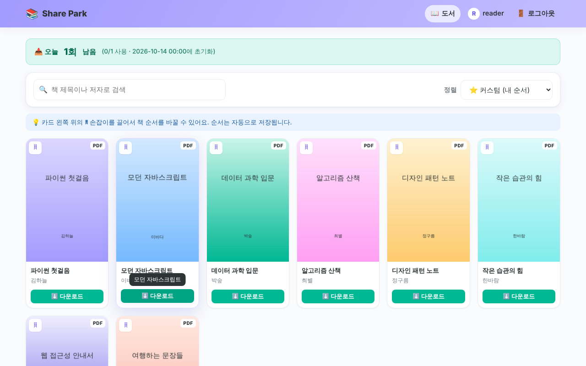

<div align="center">


# Share Park

**A lightweight, self-hosted e-book library for safely sharing your own PDF/EPUB collection with family and friends**

No database required: it runs on **plain PHP + JSON files**.

[](https://github.com/resious71/Share_Park/actions/workflows/ci.yml)
[](https://www.php.net/)
[](LICENSE)

[한국어](README.md)



</div>

> The user interface is currently in **Korean**. English UI is on the roadmap.

## Features

- **Book tiles**: 2/3/4/6-column responsive grid, search by title or author, sort by title, author, date added or custom order
- **Drag & drop ordering**: each user can save a personal order (mouse, touch and keyboard)
- **Personal-use agreement**: users must accept an agreement before every download; it is verified on the server and every acceptance is logged (user, book, time, IP, agreement version). "Don't show again for 7 days" is supported.
- **Daily download limit**: configurable count and reset time; admins are unlimited
- **My page**: profile, password change, paginated download history with search
- **Admin**: user management, book upload with progress bar, edit, delete and display order, settings, download statistics, agreement log, help pop-ups, FAQ and a first-visit tour
- **Hybrid cover extraction**: EPUB cover image, PDF first page (Imagick, `pdftoppm`, ImageMagick or pdf.js in the browser), embedded JPEG, or a generated pastel cover

## Quick start

```bash
git clone https://github.com/resious71/Share_Park.git
cd Share_Park
php -S localhost:8000 -d upload_max_filesize=64M -d post_max_size=70M
```

Open http://localhost:8000 and sign in with **admin / admin**, then change the password from **마이페이지 (My page)**.
Data files, storage folders and the default admin account are created automatically on first run.

## Requirements

- PHP 8.1+ with `json`, `mbstring`, `fileinfo`, `session`
- Recommended: `zip` (EPUB covers and metadata), `gd` (cover resizing)
- Optional: `imagick` or `poppler-utils` for server-side PDF covers

When using Nginx, deny direct access to `data/`, `uploads/`, `covers/` and `includes/` (Apache is covered by the bundled `.htaccess` files). See the [Korean README](README.md#nginx) for a sample config.

## Security

bcrypt password hashes, CSRF tokens on every state-changing request, escaped output, content-based upload validation, random stored file names, and one-time download tokens issued only after a server-recorded agreement. Report vulnerabilities as described in [SECURITY.md](SECURITY.md).

## Contributing

Issues and pull requests are welcome. Please read [CONTRIBUTING.md](CONTRIBUTING.md) first.

## Disclaimer

Share Park is intended for e-books you legally own or have the right to share. Do not use it to distribute copyrighted material without permission.

## License

[MIT](LICENSE) © 2026 resious71
