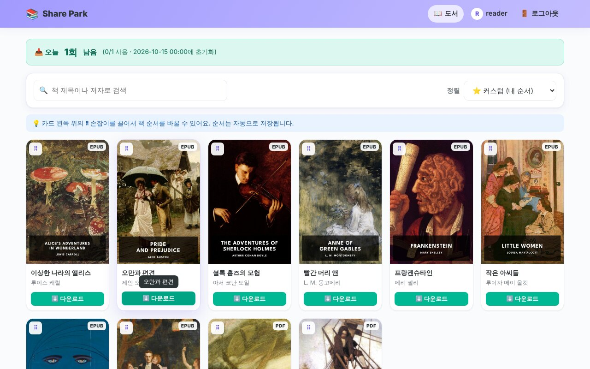
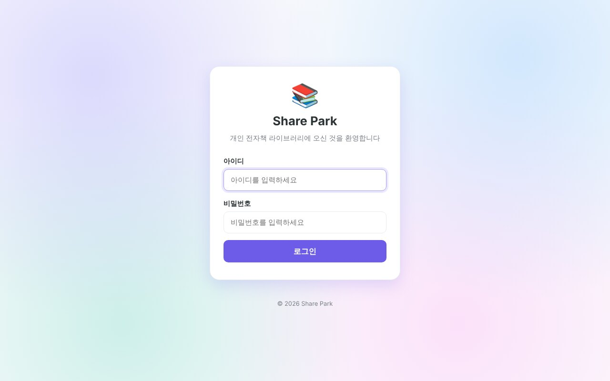
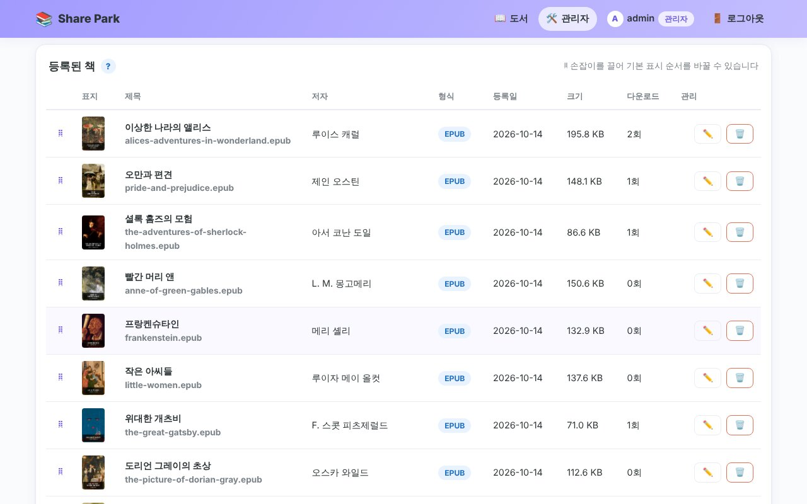
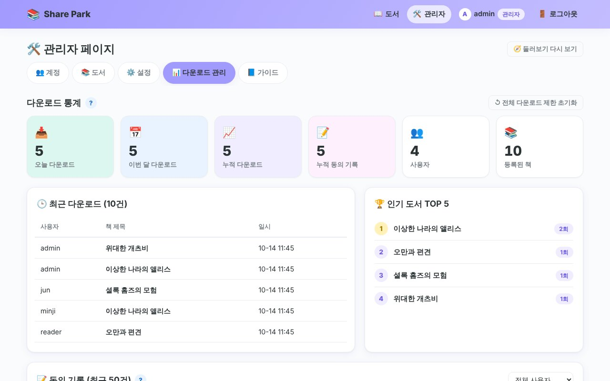
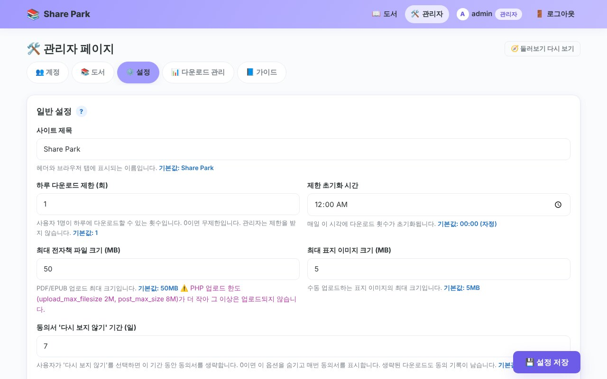
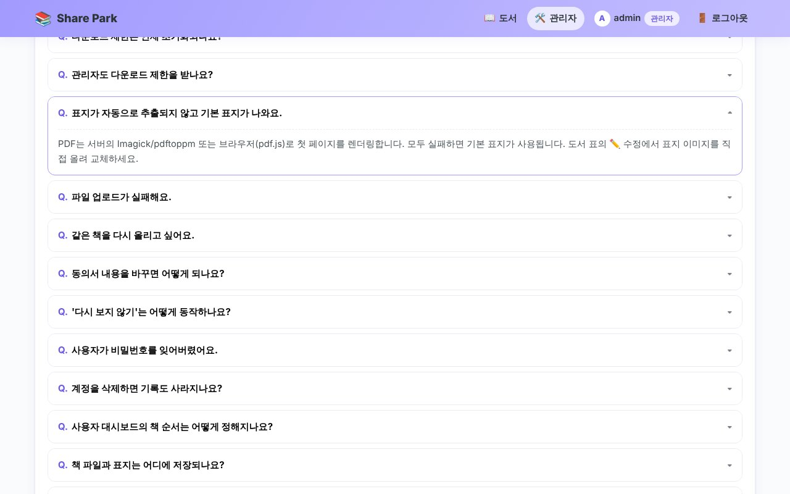
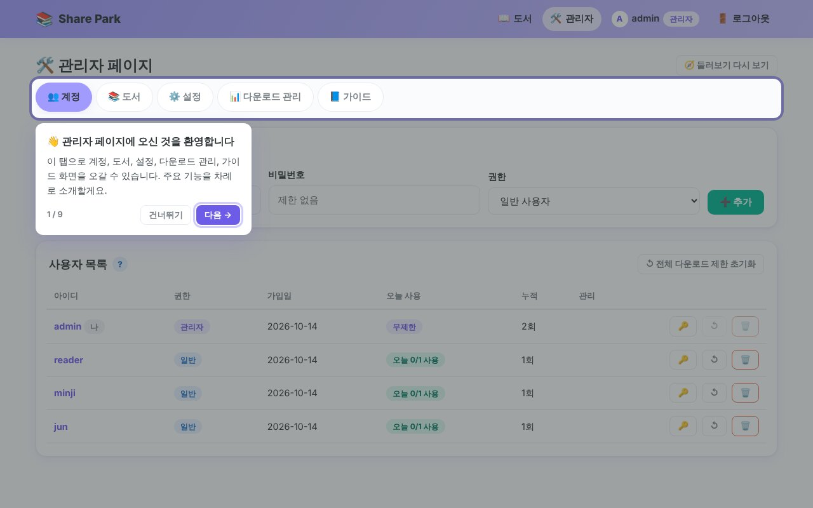
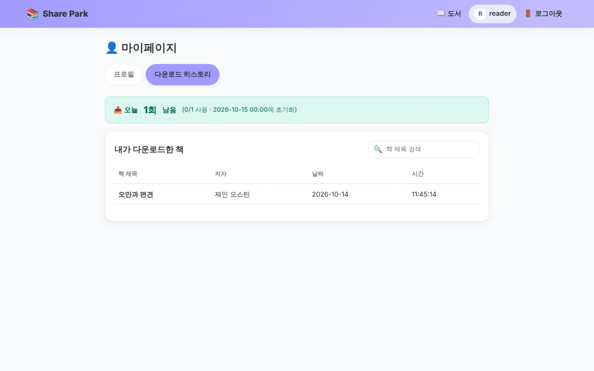
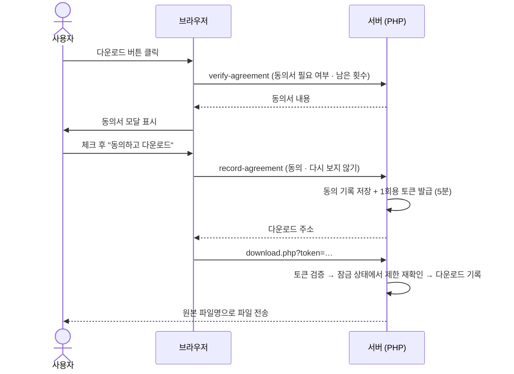

<div align="center">


# Share Park

**나만의 전자책 서재를 가족·지인과 안전하게 나누는 가벼운 셀프 호스팅 라이브러리**

PDF/EPUB 전자책을 올리고, 로그인한 사용자가 *개인용도 동의서*에 동의한 뒤 내려받을 수 있습니다.<br>
데이터베이스 없이 **순수 PHP + JSON 파일**만으로 동작합니다.

[](https://github.com/resious71/Share_Park/actions/workflows/ci.yml)
[](https://www.php.net/)
[](LICENSE)
[-00b894.svg)](#-데이터-저장-구조)
[](#-기술-스택)

[주요 기능](#-주요-기능) · [스크린샷](#-스크린샷) · [빠른 시작](#-빠른-시작) · [설치 가이드](#-설치-가이드) · [보안](#-보안) · [기여하기](#-기여하기) · [English](README.en.md)



</div>

---

## ✨ 주요 기능

<table>
<tr>
<td width="50%" valign="top">

### 📖 사용자
- **타일형 도서 목록**: 화면 크기에 따라 2·3·4·6열로 자동 조정
- **검색**: 제목·저자로 바로 찾기
- **정렬**: 커스텀(내 순서) / 제목 / 저자 / 추가일
- **드래그 앤 드롭**: 나만의 책 순서를 저장 (마우스·터치·키보드 지원)
- **남은 다운로드 배너**: "오늘 1회 남음"
- **마이페이지**: 프로필, 비밀번호 변경, 다운로드 히스토리(검색·페이지)

</td>
<td width="50%" valign="top">

### 🛠️ 관리자
- **계정 관리**: 추가 / 비밀번호 변경 / 삭제 / 제한 초기화 / 히스토리 조회
- **도서 관리**: 드래그 앤 드롭 업로드(진행률 표시), 수정, 삭제, 표시 순서
- **표지 자동 추출**: EPUB 표지, PDF 첫 페이지 (하이브리드)
- **설정**: 사이트 제목, 하루 다운로드 제한, 초기화 시각, 파일 크기, 저장 경로, 동의서 문구
- **통계**: 오늘 / 이번 달 / 누적, 최근 다운로드, 인기 도서, 동의 기록
- **가이드**: 도움말 팝업, FAQ 14개, 첫 방문 둘러보기(투어)

</td>
</tr>
</table>

### 📜 개인용도 동의서

다운로드 버튼을 누르면 동의서가 먼저 표시되고, 체크박스에 동의해야만 다운로드가 시작됩니다.
동의 여부는 **서버에서 검증**하며, 모든 동의 기록(사용자·책·시각·IP·동의서 버전)이 보관됩니다.
"7일 동안 다시 보지 않기"를 지원하고, 동의서를 고치면 버전이 올라가 모든 사용자에게 다시 표시됩니다.

## 📸 스크린샷

| 로그인 | 다운로드 동의서 |
|:---:|:---:|
|  |  |
| **관리자 · 도서 관리** | **관리자 · 다운로드 통계** |
|  |  |
| **관리자 · 설정** | **관리자 · 가이드 & FAQ** |
|  |  |
| **첫 방문 둘러보기** | **마이페이지** |
|  |  |

<details>
<summary>📱 모바일 화면 보기</summary>
<br>

</details>

## 🚀 빠른 시작

```bash
git clone https://github.com/resious71/Share_Park.git
cd Share_Park
php -S localhost:8000 -d upload_max_filesize=64M -d post_max_size=70M
```

브라우저에서 **http://localhost:8000** 에 접속해 아래 계정으로 로그인하세요.

| 아이디 | 비밀번호 |
|:---:|:---:|
| `admin` | `admin` |

> [!IMPORTANT]
> 로그인 후 **마이페이지 → 비밀번호 변경**에서 관리자 비밀번호를 꼭 바꿔 주세요.

처음 실행하면 `data/` 폴더의 JSON 파일, 책·표지 저장 폴더, 기본 관리자 계정이 자동으로 만들어집니다.

## 📦 설치 가이드

### 요구 사항

| 항목 | 내용 |
|---|---|
| PHP | **8.1 이상** |
| 필수 확장 | `json`, `mbstring`, `fileinfo`, `session` |
| 권장 확장 | `zip` (EPUB 표지·메타데이터), `gd` (표지 크기 조정) |
| 선택 | `imagick` 또는 `poppler-utils`(`pdftoppm`): PDF 표지를 서버에서 추출 |
| 웹 서버 | Apache, Nginx, IIS, PHP 내장 서버 |

### Windows (XAMPP)

1. 저장소를 `C:\xampp\htdocs\SharePark` 에 받습니다.
2. `php.ini` 에서 `upload_max_filesize = 64M`, `post_max_size = 70M` 으로 설정하고, `extension=zip`, `extension=gd`, `extension=fileinfo` 를 켭니다.
3. Apache를 시작하고 `http://localhost/SharePark` 에 접속합니다.
4. 책과 표지는 기본적으로 `C:/Users/resisa/Documents/ebook-files/` 에 저장됩니다. 경로는 `config.php` 또는 **관리자 → 설정**에서 바꿀 수 있습니다.

### Apache

저장소에 포함된 `.htaccess` 가 `data/`, `uploads/`, `covers/`, `includes/` 직접 접근을 차단합니다. `AllowOverride All` 이 켜져 있는지 확인하세요.

### Nginx

```nginx
server {
    root /var/www/Share_Park;
    index index.php;
    client_max_body_size 70m;

    # 데이터와 파일 폴더는 직접 접근 차단 (PHP를 통해서만 전송)
    location ~ ^/(data|uploads|covers|includes)/ { deny all; }
    location ~ /\. { deny all; }

    location ~ \.php$ {
        include fastcgi_params;
        fastcgi_param SCRIPT_FILENAME $document_root$fastcgi_script_name;
        fastcgi_pass unix:/run/php/php8.3-fpm.sock;
    }
}
```

## ⚙️ 설정

기본값은 `config.php`, 운영 중 변경값은 `data/settings.json` 에 저장되며 **관리자 → 설정**에서 바로 바꿀 수 있습니다.

| 설정 | 기본값 | 설명 |
|---|---|---|
| 사이트 제목 | `Share Park` | 헤더와 브라우저 탭에 표시 |
| 하루 다운로드 제한 | `1` | `0` 이면 무제한, 관리자는 항상 무제한 |
| 제한 초기화 시각 | `00:00` | 이 시각마다 사용 횟수가 0으로 초기화 |
| 최대 전자책 크기 | `50MB` | PHP `upload_max_filesize` 보다 작아야 함 |
| 최대 표지 이미지 크기 | `5MB` | JPG / PNG / WebP |
| 동의서 생략 기간 | `7일` | "다시 보지 않기" 유효 기간, `0` 이면 매번 표시 |
| 책 / 표지 저장 경로 | `uploads/`, `covers/` | Windows는 `C:/Users/resisa/Documents/ebook-files/...` |
| 동의서 문구 | 5개 조항 | `## 제목`, `- 항목`, `**강조**` 형식 |

## 🔄 다운로드는 어떻게 동작하나요?



## 🖼️ 표지 자동 추출 (하이브리드)

| 순서 | 방법 | 대상 |
|:---:|---|---|
| 1 | 관리자가 직접 올린 이미지 | 공통 |
| 2 | OPF 매니페스트의 표지 이미지 (`cover-image`, `<meta name="cover">`, guide) | EPUB |
| 3 | 서버 렌더링: Imagick → `pdftoppm` → ImageMagick `convert` | PDF |
| 4 | 브라우저 렌더링: [pdf.js](https://mozilla.github.io/pdf.js/) 로 첫 페이지 캡처 | PDF |
| 5 | PDF 안에 포함된 JPEG 이미지 | PDF |
| 6 | 제목이 들어간 파스텔 기본 표지 (SVG) | 공통 |

## 🗂️ 프로젝트 구조

```
Share_Park/
├── index.php            # 로그인
├── dashboard.php        # 도서 목록
├── mypage.php           # 마이페이지
├── admin.php            # 관리자 (계정 · 도서 · 설정 · 다운로드 관리 · 가이드)
├── logout.php
├── config.php           # 경로 · 상수 · 기본 설정
├── includes/            # 공통 함수(bootstrap.php), 레이아웃(layout.php)
├── api/                 # JSON API (로그인, 업로드, 다운로드, 동의, 통계 …)
├── css/style.css        # 파스텔 톤 디자인
├── js/                  # script · dashboard · dragdrop · agreement · mypage · admin · admin-guide
├── data/                # JSON 데이터 (자동 생성, git 제외)
├── uploads/  covers/    # 전자책 · 표지 기본 저장 폴더 (git 제외)
├── docs/                # 로고, 스크린샷
└── tests/smoke.sh       # CI 스모크 테스트
```

## 💾 데이터 저장 구조

모든 데이터는 `data/` 폴더의 JSON 파일에 저장되며, 동시 쓰기는 파일 잠금(`flock`)으로 보호됩니다.

| 파일 | 내용 |
|---|---|
| `users.json` | 사용자 (비밀번호는 bcrypt 해시) |
| `books.json` | 도서 정보와 표시 순서 |
| `settings.json` | 시스템 설정 |
| `downloads.json` | 다운로드 기록 |
| `user-custom-orders.json` | 사용자별 책 순서 |
| `download-agreements.json` | 동의 기록 (법적 대비용, 삭제하지 않음) |
| `agreement-skips.json` | "다시 보지 않기" 만료 시각 |

> [!TIP]
> **백업**: `data/` 폴더와 책·표지 저장 폴더를 함께 복사하면 됩니다.

## 🔒 보안

- 비밀번호 **bcrypt** 해시, 로그인 시 세션 ID 재발급, 연속 실패 시 응답 지연
- 모든 변경 요청에 **CSRF 토큰** 검증, 모든 출력 HTML 이스케이프
- 업로드 파일은 확장자와 **실제 내용(MIME·이미지 헤더)** 을 함께 검사하고, 저장 파일명은 서버가 무작위로 생성
- 파일은 웹에서 직접 열 수 없고, **동의 → 1회용 토큰 → 제한 재확인**을 거쳐 PHP로만 전송
- 일반 사용자는 관리자 페이지·API와 다른 사람의 기록에 접근할 수 없음

보안 취약점은 공개 이슈 대신 [SECURITY.md](SECURITY.md) 의 방법으로 알려 주세요.

## 🧰 기술 스택

| 영역 | 사용 기술 |
|---|---|
| Frontend | HTML · CSS · Vanilla JavaScript (빌드 도구 없음) |
| Backend | 순수 PHP (프레임워크 · Composer 없음) |
| 저장소 | JSON 파일 + 로컬 파일 시스템 |
| 인증 | PHP 세션 + bcrypt |
| 선택 라이브러리 | pdf.js (CDN, 브라우저 표지 추출용) |

## 🗺️ 로드맵

- [ ] 다크 모드
- [ ] 책 카테고리 / 태그
- [ ] 브라우저에서 바로 읽기 (PDF · EPUB 뷰어)
- [ ] 다국어 (English)
- [ ] Docker 이미지

아이디어가 있다면 [기능 제안](https://github.com/resious71/Share_Park/issues/new?template=feature_request.yml)으로 남겨 주세요.

## 🤝 기여하기

버그 제보, 기능 제안, 풀 리퀘스트 모두 환영합니다! 시작하기 전에 [CONTRIBUTING.md](CONTRIBUTING.md) 와 [행동 강령](CODE_OF_CONDUCT.md)을 읽어 주세요.

1. 저장소를 Fork 합니다.
2. 브랜치를 만듭니다: `git checkout -b feat/my-feature`
3. 변경 후 커밋합니다: `git commit -m "feat: 멋진 기능 추가"`
4. 푸시 후 Pull Request 를 엽니다.

변경 내역은 [CHANGELOG.md](CHANGELOG.md) 에서 확인할 수 있습니다.

## ⚖️ 이용 시 유의사항

Share Park는 **본인이 정당하게 소유하거나 배포 권한이 있는 전자책**을 개인적으로 관리·공유하기 위한 도구입니다.
저작권이 있는 자료를 무단으로 배포하는 데 사용하지 마세요. 사용에 따른 책임은 운영자에게 있습니다.

## 🙏 감사의 말

스크린샷에 쓰인 책 표지는 [Standard Ebooks](https://standardebooks.org/)(CC0)의 공개 도메인 고전 표지입니다.
표지 그림은 모두 저작권이 만료된 작품이며, 실제 서비스에서는 직접 등록한 책의 표지가 표시됩니다.

## 📄 라이선스

[MIT License](LICENSE) © 2026 resious71

<div align="center">
<sub>파스텔 톤으로 만든 작은 서재 📚 · 마음에 드셨다면 ⭐ 를 눌러 주세요!</sub>
</div>
